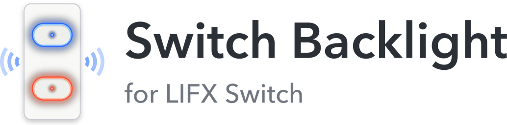

# LIFX Switch Backlight

<picture>
  <source media="(prefers-color-scheme: dark)" srcset="custom_components/lifx_switch_backlight/brand/dark_logo@2x.png">
  
</picture>

A Home Assistant integration for the **LIFX Switch**: set the button backlight color for the "on" and "off" states and the haptic feedback length, all from Home Assistant's UI.

It talks to the switch directly over your LAN. You don't need AppDaemon, aiolifx, lifx-async or the LIFX cloud. Home Assistant's built-in LIFX integration doesn't handle LIFX Switch button settings, and this integration doesn't conflict with it.

[](https://github.com/wolfsmartio/lifx_switch_backlight/releases) [](https://hacs.xyz/docs/faq/custom_repositories/) [](https://www.home-assistant.io/) [](https://github.com/wolfsmartio/lifx_switch_backlight/actions/workflows/validate.yml) [](https://github.com/wolfsmartio/lifx_switch_backlight/commits/master) [](LICENSE) [](https://community.home-assistant.io/t/lifx-switch-backlight-set-lifx-switch-backlight-colors-haptic-feedback-from-home-assistant/1030212)

> **Not affiliated with LIFX.** This is an independent, community-made integration. It is not made, endorsed or supported by LIFX or Feit Electric.

<br>

## Table of contents

**[`Installation`](#installation)**  **[`What you get`](#what-you-get-per-switch)**  **[`Action`](#action-lifx_switch_backlightset_backlight)**  **[`Moving from AppDaemon`](#moving-from-the-appdaemon-app-and-blueprint)**  **[`Translations`](#translations)**  **[`Development`](#development)**  **[`Disclaimer`](#disclaimer-and-trademarks)**  **[`License`](#license)**

<br>

## Installation

**Home Assistant lowest supported version:** 2026.10.2

The LIFX Switch is sold in the US and Canada, so HACS lists this integration for Home Assistant installs set to those countries. It works anywhere, though: if you have a LIFX Switch elsewhere, add it as a custom repository (the button below does that).

<details open>

<summary>With HACS (recommended)</summary>

<br>

[](https://my.home-assistant.io/redirect/hacs_repository/?owner=wolfsmartio&repository=lifx_switch_backlight&category=integration)

1. Click the button above. It opens HACS on your Home Assistant with this repository ready to add. If you'd rather do it by hand: in HACS, open the menu → **Custom repositories**, add `https://github.com/wolfsmartio/lifx_switch_backlight` and choose type **Integration**.
2. Install **LIFX Switch Backlight**, then restart Home Assistant.
3. Add the integration:

   [](https://my.home-assistant.io/redirect/config_flow_start/?domain=lifx_switch_backlight)

   Or go to **Settings → Devices & services → Add integration → LIFX Switch Backlight**.

</details>

<details>

<summary>Without HACS</summary>

<br>

1. Download the latest release from the [releases page](https://github.com/wolfsmartio/lifx_switch_backlight/releases).
2. Copy the `custom_components/lifx_switch_backlight` folder into your Home Assistant `config/custom_components/` folder.
3. Restart Home Assistant and add the integration as above.

Copying from a Mac over the Samba add-on? Finder can fail with error -8062 because of macOS file metadata. Use this instead (from inside the unpacked release):

```bash
rsync -rtv --inplace --delete --exclude '.DS_Store' --exclude '__pycache__' custom_components/lifx_switch_backlight/ /Volumes/config/custom_components/lifx_switch_backlight/
```

</details>

LIFX Switches on your network are found automatically. If yours isn't listed (for example because it's on a different VLAN), enter its IP address instead. Give each switch a fixed IP address (a DHCP reservation) in your router. If its address does change, the integration looks for it again by MAC address.

## What you get per switch

| Entity | What it does |
| --- | --- |
| `light.<switch>_backlight_when_on` | Backlight color while the button's load is on. Use the color wheel, or pick a white color temperature. Turning this entity off sets that backlight's brightness to 0. |
| `light.<switch>_backlight_when_off` | Same, for when the load is off. |
| `number.<switch>_haptic_feedback` | Vibration length in ms when a button is pressed (0 = off). |
| `switch.<switch>_keep_settings_applied` | Home Assistant is in charge of the settings. When on (the default), Home Assistant reads the switch every 60 seconds. If the switch's settings no longer match the ones you set in Home Assistant (for example after the switch is reset, or someone changes the backlight in the LIFX app), Home Assistant sends its settings back to the switch. The LIFX app will then show Home Assistant's settings too. Turn this off if you want changes made in the LIFX app to stay. |

These are configuration entities, so they don't show up when you target a whole area or device in an automation (for example "turn off all lights in the kitchen").

## Action: `lifx_switch_backlight.set_backlight`

Sets one or more switches in one call. Fields you leave out keep their current value.

```yaml
action: lifx_switch_backlight.set_backlight
data:
  device_id:
    - 0123456789abcdef0123456789abcdef
  haptic_duration_ms: 30
  on_hue: 240
  on_saturation: 100
  on_brightness: 100
  on_kelvin: 3500
  off_hue: 0
  off_saturation: 100
  off_brightness: 100
  off_kelvin: 2700
```

Set saturation to 0 for a white backlight at the given color temperature.

## Moving from the AppDaemon app and blueprint

1. Install this integration and add your switches.
2. Set the colors on the new entities, or call `set_backlight` once with your old blueprint values. The fields map one to one: `ms` → `haptic_duration_ms`, `on_color.hue` → `on_hue`, and so on.
3. Delete the automations made from the **LIFX Switch Backlight Control** blueprint. The daily re-send and 5-second retry aren't needed any more, because **Keep settings applied** handles that.
4. Remove `lifx_service.py` and its `lifx_control` section from AppDaemon's `apps.yaml`. If nothing else uses AppDaemon, you can remove the add-on.

## Translations

Available in English, Spanish and French. Home Assistant uses each user's profile language. If you spot a translation that could be better, or want to add a language, open a pull request: copy `translations/en.json` to your language code (for example `it.json`) and translate the text. The tests check that it has every key.

## Development

Tests run on Python 3.14 against Home Assistant 2026.10.2:

```bash
pip install "pytest-homeassistant-custom-component==0.13.373"
pytest
```

The tests include a fake switch on localhost, which checks the actual UDP packets: discovery, `GetButtonConfig` (909), `SetButtonConfig` (910), `StateButtonConfig` (911), and the `StateUnhandled` reply that lights send back.

## Disclaimer and trademarks

This project is an independent, unofficial integration. It is not affiliated with, endorsed by, sponsored by or supported by LIFX, Lifi Labs, Inc. or Feit Electric Company, Inc. For help with LIFX hardware, contact LIFX support. For help with this integration, open an issue here.

LIFX® is a registered trademark of Feit Electric Company, Inc. ([U.S. Reg. No. 4,668,299](https://tsdr.uspto.gov/#caseNumber=86002749&caseType=SERIAL_NO&searchType=statusSearch)). "LIFX" and "LIFX Switch" are used here only to say which products this integration works with. All other trademarks belong to their respective owners.

The icon and logo in `custom_components/lifx_switch_backlight/brand/` are original artwork made for this project. They do not use LIFX logos or product photos.

## License

MIT. See [LICENSE](LICENSE).
